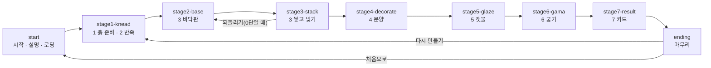
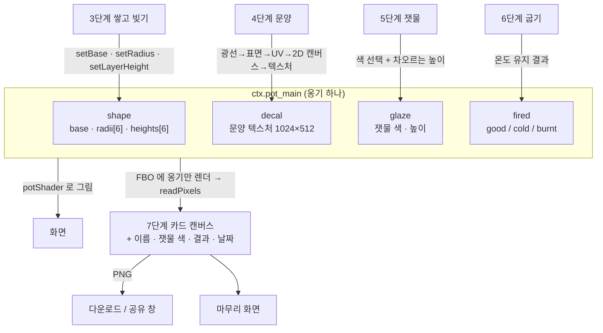

# 옹기종기 공방

> 내 손으로 빚은 옹기로 진짜 옹기를 다시 보러 가는 체험 (부천시립박물관 옹기전시실 연계)

---

## 무엇인가

**한 문장 설명:** 흙을 반죽하고, 쌓아 빚고, 문양을 그리고, 잿물을 입혀 가마에 굽는 옹기 제작 과정을 휴대폰에서 약 3분 동안 직접 해 보고, 완성한 옹기를 카드로 저장한 뒤 실제 전시실의 옹기를 다시 보게 만드는 웹 체험 콘텐츠입니다.

| 항목 | 내용 |
|---|---|
| 대상 기관 | 부천시립박물관 옹기전시실 (옹기1·2전시실) |
| 대상 사용자 | 초등~중학생 중심, 가족 관람객, 일반 관람객 |
| 놓이는 곳 | 박물관 키오스크가 아니라 **관람객 본인의 휴대폰 브라우저**. 전시실 앞 QR로 접속하며 앱 설치나 회원가입이 없습니다. 세로 화면, 한 손 터치 기준 |
| 체험 시간 | 1회 약 3분 목표 |
| 핵심 메시지 | "옹기를 빚어 보는 재미"에서 시작해 "진짜 옹기를 다시 보러 가는 경험"으로 마무리 |

**왜 만들었나:** 옹기는 손으로 만질 수 없는 전시물입니다. 제작 과정·문양·유약·굽는 온도는 패널로 설명되지만 몸으로 느끼기는 어렵습니다. 박물관에는 이미 전시실 VR 둘러보기가 있으므로, 우리는 "멀리서 보기"가 아니라 **직접 만들어 보기**에 집중했습니다. 시작 화면에서는 박물관 소장 옹기 5점(소래기·시루·굼탱이·겹단지·죽절단지)을 카드로 보여 주고, 마지막 화면에서는 "이제 진짜 옹기를 보러 가요!"로 전시실 관람을 이어 가게 합니다.

- **공개 URL:** https://kimposong.github.io/cg-2026-team6-onggi/
- **시연 영상:** <!-- [팀 입력 필요] 링크 --> (준비 중)
- **저장소:** https://github.com/kimposong/cg-2026-team6-onggi

### 체험 흐름

| 화면 | 하는 일 |
|---|---|
| 시작 | 박물관 옹기 카드 5장을 좌우로 넘겨 보고, 누르면 크게 보기. 「나도 만들어 볼래!」 / 「만드는 순서 먼저 볼래요」 |
| 시작 전 설명 | 7단계 제작 순서 안내 |
| 로딩 | 「흙을 준비하고 있어요…」 + 옹기 상식 한마디 |
| 1단계 흙 준비하기 | 아래 재료 슬롯에서 흙과 물을 끌어다 작업대에 올려 섞기 |
| 2단계 흙 반죽하기 | 게이지 바의 표시가 좋은 칸에 올 때 흙을 눌러 점수 100점 채우기 (리듬 미니게임) |
| 3단계 옹기 빚기 | 반죽을 꾹 눌러 바닥판을 만들고, 바닥 크기를 정한 뒤 흙을 한 단씩 6단까지 쌓으며 단마다 폭·높이 조절 |
| 4단계 문양 그리기 | 대나무 도구로 3D 옹기 표면에 직접 그리기, 굵기 조절, 물레 자동 회전 |
| 5단계 잿물 입히기 | 잿물 색 3가지(황갈·밤갈·흑갈) 중 하나를 고르고 잿물 그릇을 옹기에 대면 아래에서 위로 차오름 |
| 6단계 가마에 굽기 | 옹기를 가마로 끌어 넣고, 장작을 넣어 알맞은 온도를 14초 유지. 결과는 잘 구움 / 식음 / 탐 세 가지 |
| 7단계 옹기 카드 저장 | 옹기를 돌려 원하는 각도에서 촬영 → 이름을 넣은 「나만의 옹기카드」 → 이미지 저장 (PC 다운로드, 휴대폰 공유 창) |
| 마무리 | 「옹기장이가 되었어요!」 + 전시실 관람 안내. 「다시 만들기」 / 「처음으로」 |

1~6단계가 끝날 때마다 「N단계 완료」 팝업과 옹기장이 한마디(고증 설명)가 나오고, 플레이 중에는 오른쪽 위 버튼이나 ESC로 일시정지할 수 있습니다.

---

## 어떻게 실행하는가

### 필요한 것
- **WebGL2를 지원하는 브라우저** (최신 Chrome, Safari, Edge, Samsung Internet). WebGL2가 없으면 화면에 안내 문구가 나옵니다.
- 인터넷 연결 (gl-matrix를 CDN에서 불러옵니다)
- 카메라·마이크·위치 권한은 쓰지 않습니다.

### 로컬 실행
`index.html` 을 파일로 바로 열면(`file://`) 브라우저가 그림 불러오기를 막아 시작 화면에 오류 안내가 나옵니다. **반드시 로컬 서버로 여세요.**

**방법 1 — VS Code Live Server (수업 기준)**
1. VS Code에서 저장소 폴더 자체를 엽니다.
2. 확장 프로그램 `Live Server` (ritwickdey.LiveServer) 설치
3. `index.html` 을 오른쪽 클릭 → **Open with Live Server** → `http://127.0.0.1:5500/` 에서 열림

**방법 2 — Python이 있으면**
```bash
git clone https://github.com/kimposong/cg-2026-team6-onggi.git
cd cg-2026-team6-onggi
python -m http.server 5500
```
브라우저에서 `http://localhost:5500/` 을 엽니다.

**휴대폰 화면으로 보기:** PC 브라우저 개발자 도구(F12)의 기기 모드에서 세로 휴대폰 크기(예: 390×844)를 고르면 실제와 같은 배치로 보입니다. PC 가로 창에서는 배경이 세로 비율로 가운데에 놓이고 양옆이 단색입니다.

### 현장(박물관)에 놓을 때 필요한 것
- 별도 기기·설치 공간·조명 조건이 필요 없습니다. 관람객 휴대폰에서 실행되므로 **전시실 앞에 공개 URL로 연결되는 QR 안내물 하나**면 됩니다.
- 여러 관람객이 동시에 체험할 수 있습니다. 서버가 없으므로 운영 부담이 없습니다.
- 만든 옹기 카드는 관람객 휴대폰에만 저장되며, 박물관이나 다른 관람객과 공유되지 않습니다.

---

## 어떻게 만들어졌는가

### 주요 기술과 라이브러리
| 항목 | 내용 |
|---|---|
| 렌더링 | **WebGL2** 직접 사용 (Three.js 등 엔진 없음), GLSL ES 3.00 셰이더 |
| 수학 | [gl-matrix](https://glmatrix.net/) **3.4.3** (CDN, 전역 `glMatrix`) — 유일한 외부 라이브러리 |
| 언어 | JavaScript. 빌드 도구·번들러·`type="module"` 없음. 일반 `<script>` 를 순서대로 불러옵니다 |
| UI | 버튼·글자·팝업을 포함한 **모든 UI를 캔버스 안에** 그립니다. 글자는 2D 캔버스로 그려 텍스처로 올립니다 |
| 글꼴 | 배달의민족 주아체 (`assets/fonts/bmjua.ttf`) |

**수업 개념과의 연결:** 옹기 몸체는 단면 곡선을 축 둘레로 돌린 **회전체 메시**, 6단의 반지름을 잇는 곡선은 **Catmull-Rom**, 물레 회전과 장면 배치는 **모델·뷰·투영 변환**, 옹기·물레 조명은 **Phong 셰이딩과 법선 행렬**, 문양은 **광선-표면 교차 → UV → 2D 캔버스 → 텍스처**, 7단계 촬영은 **프레임버퍼(FBO)** 에 옹기만 그려 읽어 냅니다.

### 폴더 구조와 파일 역할
```
cg-2026-team6-onggi/
├─ index.html             실행 진입점. <canvas> 하나 + script 를 의존 순서대로 불러옴
├─ HANDOFF.md             개발 과정 인수인계 기록 (결정 이유·변경 이력·미결정 사항)
├─ assets/                그림·글꼴 (CREDITS.md 참고)
│  ├─ backgrounds/        전체 배경 (한옥 작업장)
│  ├─ ui/                 banners(단계 제목) · buttons · slots(재료 칸) · popups(완료·일시정지)
│  ├─ items/              끌고 다니는 재료 그림 (흙·물·잿물 그릇·장작)
│  ├─ stages/stageN/      한 단계에서만 쓰는 그림 (게이지, 대나무 도구, 잿물 색, 가마·불·온도계, 카드 틀)
│  ├─ screens/            시작·설명·로딩·마무리 화면 그림
│  ├─ cards/              박물관 옹기 카드 5장
│  └─ fonts/              주아체
├─ docs/                  수업 산출 문서
└─ src/
   ├─ main.js             WebGL2 준비, 공용 도구(ctx) 생성, 렌더 루프, 입력을 현재 화면으로 전달
   ├─ core/               도구만 (엔진 역할). 특정 화면 전용 코드는 넣지 않음
   │  ├─ program.js       셰이더 컴파일
   │  ├─ mesh.js          회전체·원판·Catmull-Rom·GPU 업로드
   │  ├─ camera.js        궤도 카메라, fitDistance, 월드→화면 좌표
   │  ├─ ui.js            캔버스 UI 셰이더: 사각형·원·글자·그림·버튼·판정
   │  ├─ text.js          글자 → 텍스처, 글꼴 불러오기, 줄바꿈
   │  ├─ image.js         그림 파일·2D 캔버스 → 텍스처
   │  └─ input.js         pointer 이벤트 → 캔버스 픽셀 좌표, 휠·핀치
   ├─ shared/             두 화면 이상이 쓰는 것
   │  ├─ potShader.js     옹기·물레 Phong 셰이더 (문양·잿물·구운 결과 포함)
   │  ├─ wheel.js         물레
   │  ├─ workbench.js     1~7단계 공통 작업대: 고정 카메라, 아래 재료 슬롯 바, 배너, 설명문, 그림 버튼
   │  └─ overlay.js       모든 화면 위에 덮는 층: 단계 완료 팝업 + 일시정지
   ├─ pot/pot.js          옹기 틀 (6단 곡선, 벽 두께, 문양·잿물·구운 결과 상태, toData/load)
   └─ scenes/             화면마다 파일 하나
      ├─ scenes.js        화면 등록·전환
      ├─ start.js         시작(카드 넘기기) · 시작 전 설명 · 로딩
      ├─ stage1-knead-bar.js   1·2단계 흙 준비 + 리듬 반죽 (화면 이름 stage1-knead)
      ├─ stage2-base.js        3단계 앞부분: 꾹 눌러 바닥판
      ├─ stage3-stack.js       3단계: 흙 쌓기 + 단마다 폭·높이 조절
      ├─ stage4-decorate.js    4단계 문양 그리기
      ├─ stage5-glaze.js       5단계 잿물 입히기
      ├─ stage6-gama.js        6단계 가마에 굽기
      ├─ stage7-result.js      7단계 촬영 · 옹기 카드 · 이미지 저장
      ├─ ending.js             마무리 화면
      ├─ stage1-knead.js       (안 씀) 1단계 리듬 게임 1안, index.html 에서 불러오지 않음
      └─ gallery/gallery.js    (빈 틀) 전시관 — 구현하지 않음
```

> ⚠️ 파일 번호와 화면의 단계 번호가 1~3단계에서 다릅니다. 화면 1·2단계 = `stage1-knead-bar.js`, 화면 3단계 = `stage2-base.js` + `stage3-stack.js`. 4~7단계는 같습니다.

### 화면(씬) 상태 전환 구조
페이지를 이동하지 않고, `Scenes` 가 지금 화면 하나를 바꿔 끼웁니다 (Unity의 SceneManager와 비슷합니다). 모든 화면 파일은 같은 약속을 지킵니다.

```js
Scenes.register('화면이름', {
  enter(ctx, data) {},   // 들어올 때. data = 이전 화면이 넘긴 옹기 데이터
  update(ctx, dt) {},    // 매 프레임 상태 갱신
  draw(ctx) {},          // 3D 그리기
  drawUI(ctx) {},        // 캔버스 UI 그리기
  down / move / up / hover / wheel / pinch / cancel,   // 입력 (필요한 것만)
  exit(ctx) { return data; }   // 떠날 때 다음 화면에 넘길 데이터
});
// 전환: ctx.go('다음화면', data) → 지금 화면 exit → 다음 화면 enter
```


- 1~6단계 사이의 전환은 모두 `Overlay.stageDone()` 이 띄우는 **완료 팝업의 「다음으로」**를 거칩니다 (2→3단계 사이인 `stage2-base` → `stage3-stack` 은 같은 단계라 팝업 없음).
- 일시정지 중에는 `main.js` 가 화면의 `update` 와 모든 입력을 멈춥니다. 「처음부터 다시」는 `start` 로 갑니다.
- **오류 상태:** WebGL2를 쓸 수 없으면 2D 캔버스로 안내 문구(`main.js`), 그림을 하나라도 못 불러오면 못 찾은 파일 이름과 Live Server 안내(`start.js`).

### 데이터 흐름
관람객이 만드는 옹기는 하나의 인스턴스 `ctx.pot_main` (`Pot.create`)이고, 단계를 지날 때마다 상태가 쌓입니다. 화면 사이에는 `toData()` 결과가 넘어갑니다.



화면 사이에 넘기는 옹기 데이터 형식:
```json
{ "base": 0.5,
  "radii":   [0.5, 0.56, 0.6, 0.6, 0.56, 0.5],
  "heights": [0.2167, 0.2167, 0.2167, 0.2167, 0.2167, 0.2167],
  "height": 1.3,
  "glaze": "#75432D",
  "fired": "good" }
```
`base` = 바닥 반지름, `radii[i]` = i번 단 중심의 반지름, `heights[i]` = i번 단의 높이, `height` = 합계(참고용). `glaze` 는 5단계 이후, `fired` 는 6단계 이후에 붙습니다.

### 렌더 루프 (`main.js`, 매 프레임)
캔버스 크기 맞추기(dpr 최대 2) → 배경 그림 → 화면 `update` → 3D `draw` → 캔버스 UI `drawUI` → 일시정지·완료 팝업 → 빌드 번호와 `ms/frame` 표시

---

## 무엇을 바꾸려면 어디를 고치는가

| 하고 싶은 것 | 고칠 곳 |
|---|---|
| 2단계 반죽 난이도 | `src/scenes/stage1-knead-bar.js` 맨 위 `PERIOD`(길수록 쉬움), `GOAL`(목표 점수). `TIERS` 는 게이지 그림의 색 띠와 맞물려 있으니 바꾸지 마세요 |
| 옹기 단 수 (6단 → 8단) | `src/pot/pot.js` 의 `BANDS` 와 기본 반지름 배열 길이. 3단계는 `Pot.BANDS` 를 따라감 |
| 옹기 크기·높이 범위 | `src/pot/pot.js` 의 `R_MIN`, `R_MAX`, `H_MIN`, `H_MAX` |
| 벽·바닥 두께 | `src/pot/pot.js` 의 `WALL_T`, `FLOOR_T` |
| 흙 색 / 물레 색 | `src/shared/potShader.js` 의 `PotShader.CLAY`, `PotShader.WOOD` |
| 물레 자국 촘촘함 | `src/shared/potShader.js` 의 `vUV.y * 180.0` |
| 3단계 휴대폰 터치 판정 너그러움 | `src/scenes/stage3-stack.js` 의 `TOUCH` |
| 3단계 고리 잡았을 때 색 | `src/scenes/stage3-stack.js` 의 `PICK` |
| 4단계 대나무 도구 커서 크기 | `src/scenes/stage4-decorate.js` 의 `TOOL_SIZE` |
| 4단계 지우기 도구 다시 보이기 | `src/scenes/stage4-decorate.js` 의 `SHOW_FINGER = true` |
| 잿물 색 종류·색 코드 | `src/scenes/stage5-glaze.js` 의 `GLAZES` (색 원 그림도 같이 교체) |
| 잿물이 차오르는 시간 | `src/scenes/stage5-glaze.js` 의 `FILL_TIME` |
| 6단계 굽기 난이도 | `src/scenes/stage6-gama.js` 맨 위 `DROP_TIME`(온도가 떨어지는 간격), `GOAL_TIME`(버틸 시간), `MAX_FAILS`(몇 번 실패하면 넘어갈 수 있나), `START_LEVEL`, `SAFE_MIN`/`SAFE_MAX` |
| 가마 그림 교체 | `src/scenes/stage6-gama.js` 의 `IMG` (그림 속 가마 입구 픽셀 좌표) |
| 7단계 카드 틀 교체 | `src/scenes/stage7-result.js` 의 `CARD` (틀 그림 속 사진·이름·글 위치 픽셀 좌표) |
| 시작 화면 박물관 옹기 카드 바꾸기·추가 | `src/scenes/start.js` 의 `CARDS` 경로 목록 + `assets/cards/` |
| 로딩 화면 시간 | `src/scenes/start.js` 의 `LOADING_TIME` |
| 완료 팝업 「다음으로」 대기 시간 | `src/shared/overlay.js` 의 `NEXT_DELAY` |
| 「처음부터 다시」 목적지 | `src/shared/overlay.js` 의 `RESTART_SCENE` |
| 물레·옹기의 화면 높이·크기 | `src/shared/workbench.js` 의 `SHIFT_Y`(1·2·5단계), `SHIFT_Y_LOW`(3·4·7단계), `SCENE_SCALE` |
| 물레 회전 속도 | `src/shared/workbench.js` `move` 의 `Math.PI * 1.5` |
| 단계 제목·안내 문구 | 위쪽 제목은 배너 **그림**(`assets/ui/banners/banner-stageN.png`)이라 그림을 바꿔야 합니다. 배너 아래 한 줄 설명은 각 단계 파일의 `Work.drawBanner(ctx, n, sub)` 와 `Work.hint([...])` 문자열 |
| 설명문 글자 크기 | `src/shared/workbench.js` 의 `SUB_TEXT_H` |
| 새 화면 추가 | `src/scenes/` 에 파일을 만들어 `Scenes.register(...)` → **`index.html` 에 script 줄 추가** (순서 = 의존 순서) |
| 수정 후 배포 | `index.html` 의 `?v=번호` 전부와 `src/main.js` 의 `BUILD` 를 같이 올리기 |

**고칠 때 주의할 점**
- 파일마다 즉시 실행 함수로 감싸 객체 하나만 전역으로 내보냅니다. 파일 맨 위에 `const` 를 새로 만들면 다른 파일과 이름이 겹쳐 `has already been declared` 오류가 납니다.
- `Mesh is not defined` 같은 오류는 `index.html` 의 script 순서 문제입니다.
- `src/shared/potShader.js` 를 고치면 `src/scenes/stage6-gama.js` 안의 굽기 셰이더 사본(`BAKE_VS/FS`)도 같이 고쳐야 합니다.
- 옹기가 새까맣게 나오면 회전체 법선 부호(`core/mesh.js`), 휴대폰에서 엉뚱한 곳이 눌리면 CSS→캔버스 픽셀 변환(`core/input.js`)을 먼저 보세요.

---

## 알려진 한계

### 지금 안 되는 것과 그 이유
| 한계 | 이유 / 현재 상태 |
|---|---|
| **전체 용량 약 46MB** (수업 기준 15MB) | 팀이 그린 원본 PNG를 그대로 씁니다. 배경 7.5MB, 박물관 카드 5장 약 15MB, 카드 틀 2.8MB, 주아체 1.5MB. 휴대폰 데이터로 처음 열면 첫 화면까지 오래 걸릴 수 있습니다 |
| **유휴 30초 자동 복귀 없음** | 구현하지 않았습니다. 관람객이 중간에 휴대폰을 내려놓아도 그 자리에 머뭅니다 (각자 휴대폰이라 다음 사람에게 넘어가는 문제는 적음) |
| **캔버스 외 UI 예외 1곳** | 7단계 이름 입력에 투명한 `<input>` 을 캔버스 위에 겹쳐 둡니다. 휴대폰 키보드는 진짜 입력칸을 사용자가 직접 눌러야만 뜨기 때문에(특히 iOS) 캔버스만으로는 방법이 없었습니다 |
| 로딩 화면이 실제 불러오기를 기다리지 않음 | 2.6초 동안 보여 주는 연출입니다. 그림이 늦게 오면 1단계에서 잠깐 단색 배경·글자 버튼이 보일 수 있습니다 |
| 카드는 기기에만 저장 | 서버가 없어 박물관이 관람객 작품을 모을 수 없습니다 |
| 되돌아가기 제한 | 4단계 이후에는 이전 단계로 돌아갈 수 없고, 7단계는 촬영 후 다시 찍을 수 없습니다 |
| 5단계 배너 문구 | 배너 그림은 "옹기를 문질러 잿물을 발라봐!"인데 실제 조작은 색 고르기 + 그릇 대기입니다 |
| 고증 추정값 | 벽 두께(`WALL_T`)와 잿물 위에 손가락으로 그린 자리의 색(`#B07A50`)은 공개 자료에서 실측치를 찾지 못해 추정한 값입니다. 확인이 필요합니다 |
| 6단계 굽기 방식 | 실제 가마 온도 시뮬레이션이 아니라 "알맞은 온도를 유지한다"는 개념만 게임으로 옮겼습니다 |
| 일시정지 중 일부 문구 타이머 | 안내 문구는 실제 시간 기준이라 일시정지를 풀면 이미 사라져 있을 수 있습니다 |
| 확인한 기기 범위 | 안드로이드 크롬, 아이폰 크롬(사파리 엔진)에서 확인했습니다. <!-- [팀 입력 필요] 실제로 확인한 기기·브라우저 목록 --> 오래된 기기의 프레임 시간은 `docs/performance.md` 참고 |

### 다음에 한다면 무엇부터
1. **그림 용량 줄이기:** 세로 2000px 이하로 줄이고 WebP/JPG로 바꾸기, 주아체는 쓰는 글자만 남기기(서브셋) 또는 woff2. 첫 화면 3초와 15MB 기준을 맞추는 것이 현장 적용의 첫 조건입니다.
2. 학예사 확인을 받아 고증 추정값(벽 두께, 그린 자리 색, 옹기장이 한마디 문구) 바로잡기
3. 6단계 굽기 셰이더 사본을 공용 `potShader.js` 하나로 합치기
4. 7단계 다시 찍기, 4단계 이후 되돌아가기
5. 관람객 작품을 모으는 전시관 (서버 또는 기관 시스템 연동이 필요)

---

## 자료 출처와 라이선스

사용한 그림·글꼴·라이브러리의 출처와 라이선스는 **[CREDITS.md](CREDITS.md)** 에 정리했습니다.

- 코드: 팀 직접 작성 (WebGL2, 일부 구조는 수업 실습 코드 기반)
- 외부 라이브러리: gl-matrix 3.4.3 (MIT)
- 글꼴: 배달의민족 주아체 — ㈜우아한형제들
- 박물관 소장 옹기 사진: 부천시립박물관 
- 이 콘텐츠의 고증 설명은 교육용으로 정리한 것이며, 기관의 공식 검토를 받은 것은 아닙니다.

---

## 팀과 기여

가톨릭대학교 미디어기술콘텐츠학과 · 2026 컴퓨터그래픽스 (최명걸 교수) · 6팀
부천문화재단 「박물관 PBL」 연계 — 대상 기관: 부천시립박물관

| 이름 | 맡은 역할 |
|---|---|
| (팀원 1) | |
| (팀원 2) | |
| (팀원 3) | |

개발 과정의 설계 결정, 바꾼 이유, 아직 정하지 않은 것은 [HANDOFF.md](HANDOFF.md) 에 날짜별로 기록되어 있습니다.
